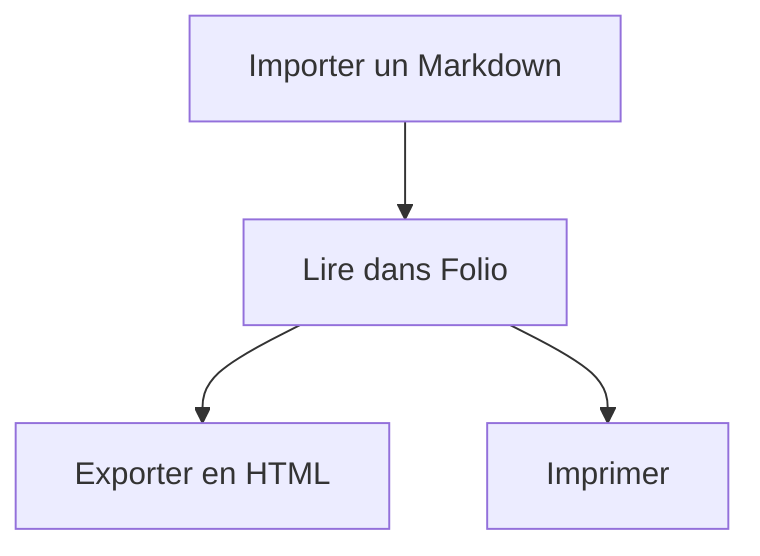

# Folio

**Un lecteur Markdown local, avec onglets, formules mathématiques, diagrammes Mermaid et export HTML.**

Folio transforme une collection de fichiers Markdown en un espace de lecture avec recherche et sommaire. Importez vos fichiers ou collez du Markdown pour créer une note datée. Ouvrez plusieurs documents, retrouvez votre collection à la prochaine visite et suivez les modifications de vos originaux si vous le souhaitez. Vous pouvez ensuite emporter une page ou toute la collection dans un HTML autonome.

Tout tient dans **[Folio.html](Folio.html)** : l’application, les bibliothèques, les styles et les polices. La conversion s’effectue dans le navigateur, sans serveur de traitement et sans envoi des documents. Le même fichier s’ouvre directement sur votre ordinateur ou se dépose sur un hébergement statique.

## Démarrer

1. Téléchargez `Folio.html`, puis ouvrez-le dans votre navigateur.
2. Cliquez sur **Importer des fichiers**, glissez vos documents dans la page, utilisez **Ouvrir un dossier** ou **Coller du Markdown**.
3. Naviguez entre les onglets. La recherche porte sur les noms et le texte ; le sommaire permet de rejoindre les titres.
4. Dans la cartouche du document actif, à gauche, **Télécharger** enregistre directement la vue affichée : fichier Markdown en mode Source, HTML autonome en mode HTML. Le bouton de téléchargement à côté du **+**, dans la barre d’onglets, exporte toute la collection en HTML.

Pour héberger Folio, déposez simplement `Folio.html` sur un hébergement statique et partagez son URL, par exemple `https://exemple.fr/Folio.html`. Aucun compte, serveur applicatif, paquet npm ni étape de compilation ne sont nécessaires pour l’utiliser. Ce dépôt ne déclenche aucune publication automatique.

L’ouverture directe depuis le disque convient à la lecture et à l’export. Les fonctions avancées de stockage et de suivi des originaux dépendent du navigateur et du contexte d’ouverture : leur disponibilité en `file://` n’est pas garantie. Un hébergement HTTPS est recommandé pour le suivi des fichiers.

## Ce que Folio propose

- Import multiple de fichiers `.md`, `.markdown`, `.mdown` et `.mkd`, encodés en UTF-8.
- Collage de Markdown depuis la page ou une zone de saisie dédiée, avec création d’un document au nom daté.
- Navigation par onglets, recherche, sommaire, mode Source, thèmes clair et sombre, interface adaptée aux petits écrans.
- Titres, listes, tableaux, citations, listes de tâches et blocs de code avec copie.
- Formules mathématiques rendues par KaTeX, avec les polices intégrées.
- Diagrammes Mermaid affichés directement dans les documents, avec leur code source consultable et copiable.
- Images locales PNG, JPEG, GIF, WebP et AVIF, et liens entre les Markdown importés.
- Téléchargement direct du document en Markdown ou en HTML selon la vue, et export de toute la collection dans un seul HTML avec ses onglets.
- Impression, y compris l’enregistrement en PDF proposé par le navigateur.
- Mémorisation locale facultative de la collection et suivi facultatif des fichiers originaux.
- Retrait d’un document depuis sa cartouche ou son onglet, avec annulation temporaire et sans modification du fichier original.

La cartouche du document actif, dans la colonne de gauche, regroupe **Source**, **Numéros**, **Suivi**, **Imprimer** et **Télécharger**. **Source** bascule vers le Markdown original ; le même bouton, devenu **HTML**, revient au rendu. **Numéros** active la numérotation dans les deux vues, avec un réglage propre à chaque fichier, conservé avec sa copie lorsque la mémorisation est activée. Chaque document possède une corbeille visible. Le panneau de suivi se déplie dans la cartouche ; le téléchargement, lui, est direct. Pendant une recherche, le document en lecture reste accessible avec la mention « En lecture · hors résultats » s’il ne correspond pas au filtre.

Changer d’onglet conserve le mode de lecture et les positions propres à chaque document, sans défilement animé pour les rétablir. Les boutons aux extrémités de la barre d’onglets permettent de replier ou de réafficher le volet des documents et, sur grand écran, celui du sommaire. La lecture utilise alors la largeur libérée.

Sur grand écran, les informations de lecture occupent la colonne de droite, juste au-dessus du sommaire. Sur un écran plus étroit, elles rejoignent la cartouche active ; sur mobile, le bouton de collection dans les onglets ouvre la colonne de gauche et ses commandes. La zone centrale reste consacrée au document, sans bandeau de métadonnées ni bandeau inférieur.

### Numéros de ligne et repères HTML

En vue **Source**, les numéros suivent les lignes du Markdown, indépendamment des retours visuels à la ligne. Ils ne sont ajoutés ni au texte copié ni au fichier Markdown téléchargé. Le nom et l’extension Markdown d’origine sont conservés au téléchargement, sans réécrire les liens du texte.

En vue **HTML**, les numéros désignent des blocs de lecture : un paragraphe, un élément de liste, un tableau, un bloc de code, une formule en bloc ou une figure. Les titres gardent leurs ancres de sommaire. Les paragraphes contenus dans un élément de liste et le contenu interne d’un tableau, d’un bloc de code ou d’une figure ne reçoivent pas de numéro supplémentaire ; les éléments d’une sous-liste ont chacun leur repère.

Ces repères ne dépendent ni de la largeur de l’écran ni de la taille du texte. Dans Folio, cliquer sur un numéro copie une référence telle que `notes.md, repère 23`. Les exports HTML conservent les numéros activés et proposent des liens vers les passages correspondants. Une référence vaut pour une même version du document : ajouter un bloc plus haut peut décaler les numéros suivants.

### Annuler un retrait

Après un retrait depuis la corbeille ou la fermeture d’un onglet, le bouton **Annuler** du message rétablit le dernier document retiré, son emplacement et ses réglages de lecture. Il reste disponible pendant **30 secondes**, tant que la page est ouverte. Le contenu n’est gardé que temporairement en mémoire, pas dans une corbeille IndexedDB.

Le retrait suivant remplace cette possibilité d’annulation. Fermer le message, vider la collection ou réimporter un document au même chemin l’annule également. Le rétablissement respecte les limites de la collection et ne remplace jamais un document déjà présent.

### Coller du Markdown

Deux possibilités :

- **Collage direct :** cliquez dans la page, hors d’un champ de saisie, puis collez avec `Ctrl V`, `⌘ V` ou la commande de collage de votre navigateur. Folio crée et affiche immédiatement le nouveau document.
- **Zone dédiée :** cliquez sur **Coller du Markdown**, collez ou préparez le texte, puis choisissez **Créer le document**. `Ctrl Entrée` ou `⌘ Entrée` valide également la saisie. Un texte refusé reste dans cette zone pour pouvoir être corrigé.

Le document reçoit un nom tel que `Collage-2026-10-23_14-05-09.md`, à partir de la date et de l’heure locales du navigateur. Si ce nom existe déjà, un suffixe `-2`, `-3`, etc. évite de remplacer un document. Il s’ouvre en mode lecture et la recherche est réinitialisée pour le rendre visible.

Le texte brut est interprété comme du Markdown : les titres, listes, blocs de code, formules et diagrammes Mermaid sont rendus normalement ; un texte simple devient un paragraphe. Folio ne convertit pas la représentation HTML du presse-papiers en Markdown. Copiez le **texte source** pour conserver ses délimiteurs de mise en forme, de mathématiques et de diagrammes. Les images et fichiers présents dans le presse-papiers doivent être ajoutés avec les commandes d’import.

Le collage dans la recherche, un champ de saisie ou un dialogue conserve son comportement habituel. Folio ne lit le presse-papiers qu’au travers de l’action de collage, sans demande d’accès automatique ou en arrière-plan. Les mêmes limites d’import et de rendu s’appliquent aux textes collés.

Un collage crée un document dans la collection du navigateur, sans écrire un fichier sur le disque ni autoriser un suivi d’original. La mémorisation facultative, le téléchargement de la source `.md` et les exports HTML permettent de le conserver comme les autres documents. Le brouillon de la zone de collage reste temporaire et n’est pas mémorisé dans IndexedDB.

### Formules mathématiques

Utilisez `$…$` ou `\(…\)` dans une phrase, et `$$…$$` ou `\[…\]` pour une formule en bloc :

```markdown
Une énergie $E = mc^2$.

$$
\int_0^1 x^2\,dx = \frac{1}{3}
$$
```

Il s’agit de la syntaxe mathématique de KaTeX, pas d’un compilateur de documents LaTeX complets. Dans les blocs de code, les formules restent du texte. Pour écrire un dollar littéral, utilisez `\$`.

Les définitions de macros utilisateur, telles que `\def` ou `\newcommand`, et les commandes internes contenant `@` ne sont pas interprétées. Leur texte reste visible et Folio signale les formules qui n’ont pas pu être rendues. Les commandes usuelles, les matrices, les intégrales et la numérotation avec `\tag` sont prises en charge.

### Diagrammes Mermaid

Placez la description du diagramme dans un bloc de code portant le langage `mermaid` :

````markdown

````

Folio affiche le diagramme directement à cet endroit du document. **Voir le code Mermaid** permet de retrouver et copier sa description ; le mode **Source** conserve le Markdown complet. Les autres blocs de code et le code en ligne restent du texte. Si la syntaxe Mermaid est invalide ou qu’une limite est dépassée, le code reste visible avec un message explicatif et le reste du document reste lisible.

Le moteur **Mermaid 12.2.0** est embarqué dans `Folio.html` : le rendu fonctionne hors connexion, y compris après import ou collage. Les diagrammes gardent un fond clair dans les deux thèmes pour préserver la lisibilité. Les actions au clic et les ressources distantes dans les diagrammes sont désactivées. Les formules internes à Mermaid respectent aussi le refus des définitions de macros et des commandes internes de Folio ; un diagramme qui en contient garde sa source avec un message.

Les exports HTML du document courant et de la collection contiennent les diagrammes sous forme d’images SVG intégrées, avec leur source consultable. Ils n’ont pas besoin du moteur Mermaid pour être lus et conservent les diagrammes à l’impression, notamment lors d’un enregistrement en PDF. Comme le reste du contenu exporté, ces diagrammes sont des copies figées.

### Images et liens entre documents

Importez les images avec vos Markdown. **Ouvrir un dossier** conserve l’arborescence et permet de résoudre des chemins tels que `images/schema.png` ou `chapitres/suite.md`. Une sélection de fichiers isolés ne fournit généralement que leurs noms ; si plusieurs fichiers portent le même nom, l’import du dossier évite les ambiguïtés.

Les images distantes sont bloquées et remplacées par un emplacement descriptif. Elles ne sont pas téléchargées automatiquement.

Les exports HTML contiennent les styles, les formules et diagrammes déjà rendus, les repères activés et les images locales utilisées. Ils sont lisibles hors connexion et constituent des copies figées. L’export de la collection garde la navigation dans un seul fichier. Les exports HTML individuels conservent des liens vers les autres pages `.html` : pour les utiliser ensemble, placez-les selon l’arborescence relative d’origine. Le téléchargement Markdown conserve les chemins d’images du texte source ; il n’incorpore pas les fichiers d’images.

Quand plusieurs documents produiraient le même nom HTML, Folio leur attribue des noms distincts et adapte leurs liens : `note.md` et `note.markdown` deviennent par exemple `note.md.html` et `note.markdown.html`. Les suffixes supplémentaires éventuels sont déterministes pour une même collection.

## Confidentialité et conservation locale

Folio ne téléverse pas les fichiers importés. Il n’utilise ni service de conversion, ni analyse d’audience, ni cookie. Les bibliothèques et les polices sont embarquées ; aucun CDN n’est nécessaire pendant l’utilisation. Le HTML contenu dans les Markdown est nettoyé avant affichage.

Une version hébergée est naturellement téléchargée depuis son hébergeur à l’ouverture. Le contenu des fichiers importés n’est pas envoyé à celui-ci. Les liens web ne s’ouvrent que lorsque vous cliquez dessus, sans transmettre l’adresse de la page Folio.

Ces propriétés décrivent le code fourni dans ce dépôt. Choisissez une version et un hébergement de confiance : une personne pouvant modifier le HTML ou les scripts servis peut également modifier leur comportement. Pour un usage entièrement hors réseau, utilisez une copie de `Folio.html` enregistrée sur votre ordinateur.

### Retrouver sa collection à la prochaine ouverture

La case **Mémoriser cette collection sur cet appareil** est décochée par défaut. En l’activant, vous autorisez l’enregistrement d’une copie des documents et des images dans IndexedDB, le stockage local de ce navigateur. Attendez le message **Collection mémorisée** avant de fermer la page.

- Les ajouts, les mises à jour et les retraits sont enregistrés pendant la session.
- Le document sélectionné, le mode Source/HTML, la numérotation et les positions des deux vues sont conservés pour chaque fichier. La position est enregistrée après une courte pause dans le défilement ; attendez la confirmation de mémorisation avant de fermer.
- La corbeille d’une cartouche supprime ce document de la collection et arrête son suivi. Elle ne supprime ni ne modifie son fichier original.
- Fermer un onglet de document le retire aussi de la collection mémorisée.
- **Vider la collection** retire les documents et les images de Folio.
- Décocher la case supprime la copie enregistrée et garde la collection actuellement affichée en mémoire. Vérifiez la confirmation de l’effacement si une erreur est signalée.

La restauration concerne la même page, la même origine et le même profil de navigateur. Il n’y a pas de synchronisation entre appareils. Un conflit entre deux pages ouvertes suspend l’enregistrement de la page devenue obsolète pour éviter qu’elle écrase l’autre collection.

**Folio ne chiffre pas la copie mémorisée.** Les données sont accessibles aux scripts exécutés sous la même origine — le même protocole, hôte et port. Le chemin de la page distingue les collections dans Folio, mais ne crée pas d’isolation de sécurité entre les pages d’un même site. Pour des documents sensibles, utilisez une origine de confiance, idéalement dédiée à Folio, et un profil de navigateur dont vous maîtrisez l’accès.

La documentation MDN explique les [règles d’isolation par origine du navigateur](https://developer.mozilla.org/en-US/docs/Web/Security/Defenses/Same-origin_policy).

Le stockage reste soumis aux autorisations, aux quotas et aux règles du navigateur. La navigation privée ou l’effacement des données du site peut supprimer les copies. Une fermeture pendant un enregistrement peut interrompre celui-ci. Conservez vos originaux et utilisez l’export HTML pour disposer d’une copie indépendante.

### Suivre un original modifié dans un éditeur

1. Ouvrez le document dans Folio, puis cliquez sur **Suivi**, dans sa cartouche à gauche.
2. Cochez **Recharger automatiquement**.
3. Dans le sélecteur du navigateur, choisissez le fichier Markdown original correspondant.

L’accès est **en lecture seule**. Folio vérifie les modifications environ toutes les deux secondes lorsque la page est visible, ainsi qu’au retour sur la page, et attend une courte stabilité du fichier avant de le relire. Il actualise alors le rendu, les formules, les diagrammes et le sommaire. Les modifications de votre éditeur doivent être enregistrées sur le disque pour être visibles.

Chaque document possède son propre réglage. Les vérifications sont suspendues lorsque la page est cachée et s’arrêtent lorsque Folio est fermé. Les images restent des copies importées séparément ; autoriser un Markdown ne donne pas accès aux fichiers voisins.

Si la mémorisation de la collection est activée, Folio conserve aussi le réglage et, lorsque le navigateur le permet, la référence autorisée vers l’original. À la prochaine ouverture, la copie mémorisée s’affiche ; le suivi reprend si l’autorisation reste valide. Sinon, utilisez **Rétablir l’accès** ou **Choisir l’original**. Aucun dialogue d’autorisation n’est ouvert automatiquement. Un simple chemin écrit dans un document ne donne pas accès au fichier sur le disque.

Décocher le suivi arrête les lectures et retire cette liaison de la collection ; cela ne révoque pas les permissions gérées par le navigateur. Retirer le document arrête également son suivi. Réimporter un fichier au même chemin remplace son contenu et désactive son ancien suivi : reliez explicitement l’original pour reprendre les mises à jour. Un fichier déplacé ou remplacé par un éditeur peut nécessiter **Choisir à nouveau**.

Le suivi utilise l’API File System Access et nécessite un navigateur compatible, notamment Chrome ou Edge sur ordinateur, dans un contexte autorisé. Il n’est pas disponible dans tous les navigateurs et son fonctionnement en `file://` n’est pas garanti. L’import classique, le rendu et l’export restent disponibles sans cette API. Les exports HTML n’embarquent aucune autorisation d’accès aux originaux.

## Repères et limites

| Élément | Limite ou comportement |
| --- | --- |
| Un Markdown | 5 Mio, UTF-8 |
| Une image | 15 Mio |
| Une collection importée | 80 Mio de fichiers source, 200 documents et 3 000 images au maximum |
| Une sélection de fichiers | 3 000 fichiers au maximum par import |
| Un glisser-déposer de fichiers ou de dossiers | 3 000 entrées au maximum, profondeur de dossiers limitée à 64 |
| Formules | 1 000 par document ; 16 384 caractères par formule ; 131 072 caractères de formules au total |
| Diagrammes Mermaid | 50 par document ; 16 384 caractères par diagramme ; 131 072 caractères de diagrammes au total ; 1 Mio de SVG par diagramme |
| Structure du rendu | 40 000 nœuds par document ; 200 000 pour la collection |
| Numérotation de la source | 40 000 lignes au maximum ; au-delà, le texte reste consultable sans numéros |
| Un export HTML | Budget de 80 Mio, évalué par une estimation conservatrice avant sa création |
| Recherche | `Ctrl K` ou `⌘ K` |
| Coller un document | `Ctrl V` ou `⌘ V` hors des champs de saisie |
| Valider la zone de collage | `Ctrl Entrée` ou `⌘ Entrée` |
| Onglets | Flèches gauche/droite, `Début` et `Fin` ; `Suppr` pour fermer |
| Extensions non interprétées | Notes de bas de page, macros de documents LaTeX |

Les limites de rendu et d’export protègent la réactivité du navigateur lorsqu’un petit Markdown produit un très grand HTML, par exemple avec de nombreuses formules ou une image répétée. Un document trop complexe ou un export trop volumineux est refusé avec un message. Le budget d’export est distinct de la taille des fichiers importés ; une estimation conservatrice peut refuser un export dont la taille finale aurait été légèrement inférieure à 80 Mio. Dans ce cas, exportez moins de documents ou réduisez les répétitions d’images et les formules très longues.

## Développer

`Folio.html` est le fichier principal généré et distribué. Modifiez les fichiers de `src/`, puis reconstruisez-le. Les dépendances nécessaires à l’exécution sont déjà présentes dans `vendor/`.

Les garde-fous techniques du renderer sont exposés dans `FolioRenderer.limits` : 100 000 étapes de lexage, profondeur maximale de 128, HTML rendu limité à 16 Mio par document et HTML mathématique limité à 1 Mio par formule. KaTeX utilise `trust:false`, `maxExpand:256` et `maxSize:20`. Ces plafonds complètent les limites de fichiers, de formules et de nœuds décrites ci-dessus ; ils bornent les cas d’amplification identifiés sans garantir un temps de traitement identique sur toutes les machines.

| Chemin | Rôle |
| --- | --- |
| `Folio.html` | Application autonome à ouvrir ou à héberger |
| `src/` | Gabarit HTML, interface, rendu, stockage, suivi et styles |
| `vendor/` | Bibliothèques et polices embarquées |
| `scripts/build.py` | Assemblage du fichier autonome |
| `tests/` | Scénarios automatisés et utilitaires de test |
| `licenses/` | Textes complets des licences tierces |
| `THIRD_PARTY_NOTICES.md` | Versions, provenance et intégration des composants tiers |
| `AUDIT.md` | Défauts corrigés, validation, références de sécurité et limites de l’audit |

### Reconstruire

Python 3 suffit ; l’assemblage ne télécharge rien :

```sh
python3 scripts/build.py
```

Pour vérifier que le fichier distribué correspond exactement aux sources, sans le réécrire :

```sh
python3 scripts/build.py --check
```

### Lancer les tests

Utilisez une version compatible de Node.js, **Node 22.22.2 ou plus récent dans la branche 22 recommandé**. Les versions acceptées sont indiquées dans `package.json`.

```sh
npm ci && npm test
```

`npm ci` installe les dépendances de développement. Les tests couvrent le rendu et la sécurité, l’intégration des diagrammes Mermaid, les exports, la conservation locale et le suivi des originaux. Les rapports sont écrits dans `tests/output/`.

Ces tests exécutent l’application dans **jsdom**, avec IndexedDB simulé, des références de fichiers simulées et des événements de collage construits pour les scénarios. La suite Mermaid remplace le moteur de disposition par des SVG déterministes pour vérifier l’intégration, les erreurs, les limites et les exports. Ce sont des tests du DOM et de la logique applicative, pas des tests dans un véritable navigateur. Le presse-papiers système, les dialogues natifs, les autorisations File System Access, le rendu visuel, les téléchargements et les variations entre navigateurs doivent aussi être vérifiés manuellement.

## Licences

La licence du code propre à Folio **reste à définir par le propriétaire du dépôt**. Aucune licence globale n’est choisie ici.

Les composants tiers conservent leurs licences respectives : MIT pour Marked, KaTeX et Mermaid, Apache 2.0 pour la distribution de DOMPurify utilisée ici, et SIL Open Font License 1.1 pour les polices KaTeX. Les dépendances incluses dans la distribution de Mermaid conservent également leurs notices propres. Consultez [THIRD_PARTY_NOTICES.md](THIRD_PARTY_NOTICES.md) et le dossier [licenses/](licenses/). Les notices intégrées doivent être conservées lors de la redistribution des composants concernés.
